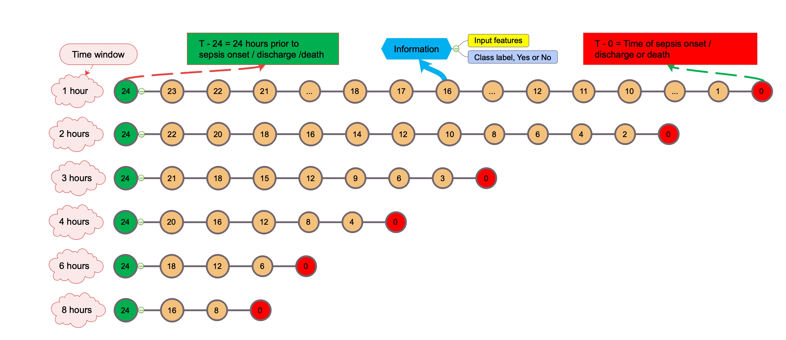
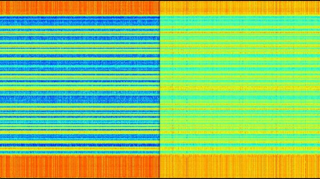

# PhD Research Archive

This repository is an index of the code, papers, slides, posters, videos, and demos from my PhD research at Stockholm University (2018–2024), with my earlier Master's thesis included at the end.

My thesis points readers to my GitHub profile for research code. I now use that profile mainly for current engineering work, so this archive keeps the research easy to find without taking over the pinned section.

The original code repositories stay where they are. This repository only gives them one stable starting point.

## PhD thesis

**Advancing Clinical Decision Support Using Machine Learning & the Internet of Medical Things: Enhancing COVID-19 & Early Sepsis Detection**  
Department of Computer and Systems Sciences, Stockholm University, 2024.

## Media gallery

Quick links to the slides, posters, videos, and demos that go with the research.

<table>
<tr>
<td width="50%" valign="top">
<strong>🎓 PhD public defence</strong>  
<a href="https://mahbub.blogs.dsv.su.se/files/2025/02/defence_presentation_slides.pdf">📑 Defence slides (PDF)</a> 
<a href="https://mahbub.blogs.dsv.su.se/files/2025/09/PhD_defence_28-03-2024_Mahbub_Ul_Alam.mp4">▶️ Watch the defence (MP4)</a>
</td>
<td width="50%" valign="top">
<strong>🖼️ Paper I — Federated semi-supervised COVID-19 detection</strong>  
<a href="https://mahbub.blogs.dsv.su.se/files/2022/05/poster_Mahbub_Ul_Alam.pdf">📌 Conference poster (PDF)</a>
</td>
</tr>
<tr>
<td width="50%" valign="top">
<strong>🌡️ Paper II — Thermal + tabular COVID-19 detection</strong>  
<a href="https://github.com/anondo1969/thremaltimodal-covidetector/raw/main/slides_and_results/presentation_slides_v3.pdf">📑 Presentation slides (PDF)</a>
</td>
<td width="50%" valign="top">
<strong>🩺 Paper IV — FedSepsis</strong>  
<a href="https://mahbub.blogs.dsv.su.se/files/2023/01/FedSepsis_Mahbub_Ul_Alam.pdf">📑 Presentation slides (PDF)</a>
</td>
</tr>
<tr>
<td width="50%" valign="top">
<strong>🫁 Paper V — LRP &amp; Grad-CAM</strong>  
<a href="https://mahbub.blogs.dsv.su.se/files/2022/07/presentation_slides.pdf">📑 Presentation slides (PDF)</a> 
<a href="https://mahbub.blogs.dsv.su.se/files/2022/07/presentation_video_extended.mp4">▶️ Extended presentation (MP4)</a>
</td>
<td width="50%" valign="top">
<strong>🩻 SHAMSUL — Explainable chest X-ray AI</strong>  
<a href="https://shamsul.serve.scilifelab.se/">🚀 Open the live SHAMSUL demo</a> 
<a href="https://github.com/anondo1969/SHAMSUL">💻 View code and results</a>
</td>
</tr>
<tr>
<td width="50%" valign="top">
<strong>🎤 More talks from the PhD years</strong>  
<a href="#other-presentations-from-the-phd-years">Browse conference slides and videos ↓</a>
</td>
<td width="50%" valign="top">
<strong>📚 Full presentation archive</strong>  
<a href="https://mahbub.blogs.dsv.su.se/publication-presentation-slides/">Browse slides, posters and videos ↗</a>
</td>
</tr>
</table>

## Thesis papers at a glance

| Paper | Main topic | Code |
|---|---|---|
| VI | SHAMSUL: comparing several local interpretability methods for chest radiography | [`SHAMSUL`](https://github.com/anondo1969/SHAMSUL) |
| V | LRP and Grad-CAM for interpreting chest X-ray models | [`lrp-grad_cam-chexpert`](https://github.com/anondo1969/lrp-grad_cam-chexpert) |
| IV | Federated multimodal early sepsis detection on edge devices | [`FedSepsis`](https://github.com/anondo1969/FedSepsis) |
| III | IoMT architecture and deep learning for early sepsis detection | [`FedSepsis/single_server_setting`](https://github.com/anondo1969/FedSepsis/tree/main/FedSepsis_codes/single_server_setting) |
| II | Multimodal COVID-19 detection from thermal images and tabular data | [`thremaltimodal-covidetector`](https://github.com/anondo1969/thremaltimodal-covidetector) |
| I | Federated and semi-supervised learning for COVID-19 detection and lung segmentation | [`FedSemiCovidDetector`](https://github.com/anondo1969/FedSemiCovidDetector) |

---

## Paper VI — SHAMSUL

**SHAMSUL: Systematic Holistic Analysis to investigate Medical Significance Utilizing Local interpretability methods in deep learning for chest radiography pathology prediction**

SHAMSUL compares Grad-CAM, LRP, LIME, and SHAP for explaining chest X-ray pathology predictions. It evaluates the explanations in several ways, including comparison with expert annotations. A public demo lets people explore the methods without setting up the research environment.

**Main themes:** explainable AI · Grad-CAM · LRP · LIME · SHAP · medical imaging · model interpretation · clinical decision support

---

## Paper V — LRP and Grad-CAM for chest X-ray interpretation

**Exploring LRP and Grad-CAM visualization to interpret multi-label-multi-class pathology prediction using chest radiography**

This project compares Layer-wise Relevance Propagation (LRP) and Grad-CAM for explaining multi-label chest X-ray predictions. LRP gives detailed relevance maps, while Grad-CAM gives broader regions of attention. The paper received the Best Student Paper Award at IEEE CBMS 2022.

**Main themes:** explainable AI · LRP · Grad-CAM · CheXpert · chest X-ray · multi-label classification

---

## Paper IV — FedSepsis

**FedSepsis: A Federated Multi-Modal Deep Learning-Based Internet of Medical Things Application for Early Detection of Sepsis from Electronic Health Records Using Raspberry Pi and Jetson Nano Devices**

FedSepsis combines structured EHR data and clinical text for early sepsis prediction. It uses federated learning for distributed training, ClinicalBERT for text features, missing-data handling, and experiments on Raspberry Pi and Jetson Nano devices. The project also records system behaviour such as CPU, memory, temperature, disk use, and network traffic.

**Main themes:** federated learning · multimodal EHR · ClinicalBERT · missing data · Raspberry Pi · Jetson Nano · edge computing · sepsis

---

## Paper III — IoMT architecture for early sepsis detection

**Cognitive Internet of Medical Things Architecture for Decision Support Tool to Detect Early Sepsis Using Deep Learning**

This work describes an IoMT architecture for early sepsis detection from electronic health records. The main problem is practical: clinical data are sparse, heterogeneous, and spread across systems. The project connects data preparation, model inference, and decision-support components into one architecture.

The implementation for this paper is kept inside the `FedSepsis` repository rather than in a separate repository.

**Main themes:** sepsis · electronic health records · data pipelines · deep learning · heterogeneous medical data · IoMT

---

## Paper II — Multimodal COVID-19 detection with thermal and tabular data

**COVID-19 detection from thermal image and tabular medical data utilizing multi-modal machine learning**

This project asks whether thermal images add useful information when combined with tabular medical data. It compares single-modality and multimodal models and studies which combination gives the best COVID-19 detection performance.

**Main themes:** multimodal learning · thermal imaging · tabular data · machine learning · COVID-19

---

## Paper I — Federated semi-supervised COVID-19 detection and lung segmentation

**Federated Semi-Supervised Multi-Task Learning to Detect COVID-19 and Lungs Segmentation Marking Using Chest Radiography Images and Raspberry Pi Devices: An Internet of Medical Things Application**

This project studies COVID-19 detection and lung segmentation from chest X-rays when labelled data are limited and patient data cannot simply be collected in one place. It combines federated learning, semi-supervised learning, transfer learning, and multi-task learning, and tests the setup on Raspberry Pi devices.

**Main themes:** federated learning · semi-supervised learning · multi-task learning · chest X-ray · Raspberry Pi · IoMT

---

## Other presentations from the PhD years

Some related publications are not part of the six-paper thesis core, but their presentation material is still useful:

- **Terminology expansion with prototype embeddings (2021):** [slides](https://mahbub.blogs.dsv.su.se/files/2021/02/HEALTHINF_2021_presentation_slides_Mahbub_Ul_Alam.pdf)
- **Intelligent context-based healthcare metadata aggregator (2020):** [presentation video](https://mahbub.blogs.dsv.su.se/files/2022/05/presentation.mp4)
- **Deep learning from sparse medical data for early sepsis prediction (2020):** [slides](https://mahbub.blogs.dsv.su.se/files/2020/04/HEALTHINF_2020_presentation_slides_Mahbub_Ul_Alam.pdf) · [presentation video](https://mahbub.blogs.dsv.su.se/files/2022/05/early_detection_of_sepsis_Mahbub_Ul_Alam.mp4)

The full set is also available on the [presentation resources page](https://mahbub.blogs.dsv.su.se/publication-presentation-slides/).

---

## Earlier research — Master's thesis

### From Speech to Image

**From Speech to Image: A Novel Approach to Understand the Hidden Layer Mechanisms of Deep Neural Networks in Automatic Speech Recognition**  
Master's thesis, University of Stuttgart, 2017.

This project visualizes internal neural-network representations in automatic speech recognition. It was my earlier work on model interpretation, before the medical-imaging projects in the PhD.

**Main themes:** speech recognition · interpretability · LRP · TensorFlow · Kaldi · neural networks

---
