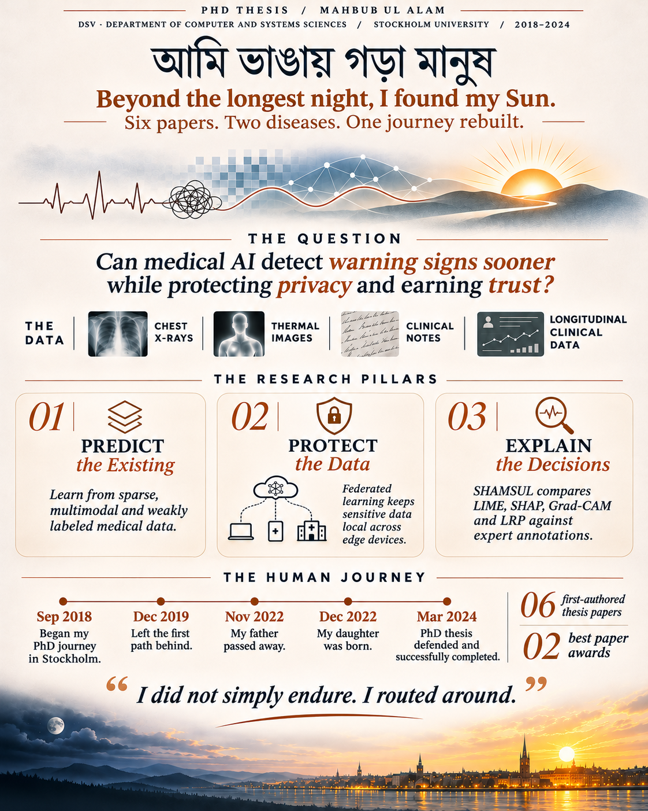

# PhD Research Archive

You can find the original research paper code repositories in the table [Thesis papers at a glance](#thesis-papers-at-a-glance) below (click the link to go there directly).

My PhD thesis points readers to my GitHub profile for research code. This archive is here to help them find it easily.

This repository is an index of the code, papers, slides, posters, videos, and demos from my PhD research at Stockholm University (2018–2024), with my earlier Master's thesis included at the end.

---

## About me

Mahbub Ul Alam

mahbub.ul.alam.anondo@gmail.com

[SciLifeLab Profile](https://www.scilifelab.se/data-centre/mahbub-ul-alam/) · [LinkedIn](https://www.linkedin.com/in/anondo) · [Google Scholar](https://scholar.google.com/citations?hl=en&user=lIfPGYcAAAAJ&view_op=list_works&sortby=pubdate)

---

## PhD thesis

**Advancing Clinical Decision Support Using Machine Learning & the Internet of Medical Things: Enhancing COVID-19 & Early Sepsis Detection**  
Department of Computer and Systems Sciences, Stockholm University, 2024.

[Doctoral Degree Conferment Ceremony – Stockholm University, September 27, 2024, at Stockholm City Hall](https://www.su.se/english/news/festive-celebrations-in-the-city-hall-1.768138)

---

## Thesis papers at a glance

| Paper | Title | Code |
|---|---|---|
| VI | SHAMSUL: Systematic Holistic Analysis to investigate Medical Significance Utilizing Local interpretability methods in deep learning for chest radiography pathology prediction | [`SHAMSUL`](https://github.com/anondo1969/SHAMSUL) |
| V | Exploring LRP and Grad-CAM visualization to interpret multi-label-multi-class pathology prediction using chest radiography | [`lrp-grad_cam-chexpert`](https://github.com/anondo1969/lrp-grad_cam-chexpert) |
| IV | FedSepsis: A Federated Multi-Modal Deep Learning-Based Internet of Medical Things Application for Early Detection of Sepsis from Electronic Health Records Using Raspberry Pi and Jetson Nano Devices | [`FedSepsis`](https://github.com/anondo1969/FedSepsis) |
| III | Cognitive Internet of Medical Things Architecture for Decision Support Tool to Detect Early Sepsis Using Deep Learning | [`Code`](https://github.com/anondo1969/FedSepsis/tree/main/FedSepsis_codes/single_server_setting/sepsis_prediction/1_numeric) |
| II | COVID-19 detection from thermal image and tabular medical data utilizing multi-modal machine learning | [`thremaltimodal-covidetector`](https://github.com/anondo1969/thremaltimodal-covidetector) |
| I | Federated Semi-Supervised Multi-Task Learning to Detect COVID-19 and Lungs Segmentation Marking Using Chest Radiography Images and Raspberry Pi Devices: An Internet of Medical Things Application | [`FedSemiCovidDetector`](https://github.com/anondo1969/FedSemiCovidDetector) |

---

## Paper VI — SHAMSUL

**SHAMSUL: Systematic Holistic Analysis to investigate Medical Significance Utilizing Local interpretability methods in deep learning for chest radiography pathology prediction**

SHAMSUL compares Grad-CAM, LRP, LIME, and SHAP for explaining chest X-ray pathology predictions. It evaluates the explanations in several ways, including comparison with expert annotations. A public demo lets people explore the methods without setting up the research environment.

**Main themes:** explainable AI · Grad-CAM · LRP · LIME · SHAP · medical imaging · model interpretation · clinical decision support

---

## Paper V

**Exploring LRP and Grad-CAM visualization to interpret multi-label-multi-class pathology prediction using chest radiography**

This project compares Layer-wise Relevance Propagation (LRP) and Grad-CAM for explaining multi-label chest X-ray predictions. LRP gives detailed relevance maps, while Grad-CAM gives broader regions of attention. The paper received the Best Student Paper Award at IEEE CBMS 2022.

**Main themes:** explainable AI · LRP · Grad-CAM · CheXpert · chest X-ray · multi-label classification

---

## Paper IV

**FedSepsis: A Federated Multi-Modal Deep Learning-Based Internet of Medical Things Application for Early Detection of Sepsis from Electronic Health Records Using Raspberry Pi and Jetson Nano Devices**

FedSepsis combines structured EHR data and clinical text for early sepsis prediction. It uses federated learning for distributed training, ClinicalBERT for text features, missing-data handling, and experiments on Raspberry Pi and Jetson Nano devices. The project also records system behaviour such as CPU, memory, temperature, disk use, and network traffic.

**Main themes:** federated learning · multimodal EHR · ClinicalBERT · missing data · Raspberry Pi · Jetson Nano · edge computing · sepsis

---

## Paper III

**Cognitive Internet of Medical Things Architecture for Decision Support Tool to Detect Early Sepsis Using Deep Learning**

This work describes an IoMT architecture for early sepsis detection from electronic health records. The main problem is practical: clinical data are sparse, heterogeneous, and spread across systems. The project connects data preparation, model inference, and decision-support components into one architecture.

The implementation for this paper is kept inside the `FedSepsis` repository rather than in a separate repository.

**Main themes:** sepsis · electronic health records · data pipelines · deep learning · heterogeneous medical data · IoMT

---

## Paper II

**COVID-19 detection from thermal image and tabular medical data utilizing multi-modal machine learning**

This project asks whether thermal images add useful information when combined with tabular medical data. It compares single-modality and multimodal models and studies which combination gives the best COVID-19 detection performance.

**Main themes:** multimodal learning · thermal imaging · tabular data · machine learning · COVID-19

---

## Paper I

**Federated Semi-Supervised Multi-Task Learning to Detect COVID-19 and Lungs Segmentation Marking Using Chest Radiography Images and Raspberry Pi Devices: An Internet of Medical Things Application**

This project studies COVID-19 detection and lung segmentation from chest X-rays when labelled data are limited and patient data cannot simply be collected in one place. It combines federated learning, semi-supervised learning, transfer learning, and multi-task learning, and tests the setup on Raspberry Pi devices.

**Main themes:** federated learning · semi-supervised learning · multi-task learning · chest X-ray · Raspberry Pi · IoMT

---

## Other presentations from the PhD years

Some related publications are not part of the six-paper thesis core, but their presentation material is still useful:

- **Terminology Expansion with Prototype Embeddings: Extracting Symptoms ofUrinary Tract Infection from Clinical Text (2021):** [slides](https://mahbub.blogs.dsv.su.se/files/2021/02/HEALTHINF_2021_presentation_slides_Mahbub_Ul_Alam.pdf)
- **Intelligent context-based healthcare metadata aggregator in internet of medical things platform (2020):** [presentation video](https://mahbub.blogs.dsv.su.se/files/2022/05/presentation.mp4)
- **Deep Learning from Heterogeneous Sequences of Sparse Medical Data for Early Prediction of Sepsis (2020):** [slides](https://mahbub.blogs.dsv.su.se/files/2020/04/HEALTHINF_2020_presentation_slides_Mahbub_Ul_Alam.pdf) · [presentation video](https://mahbub.blogs.dsv.su.se/files/2022/05/early_detection_of_sepsis_Mahbub_Ul_Alam.mp4) · [Best Paper Award](https://healthinf.scitevents.org/PreviousAwards.aspx#2020)

The full set is also available on the [presentation resources page](https://mahbub.blogs.dsv.su.se/publication-presentation-slides/).

---

## Earlier research — Master's thesis

### From Speech to Image

**From Speech to Image: A Novel Approach to Understand the Hidden Layer Mechanisms of Deep Neural Networks in Automatic Speech Recognition**  
Master's thesis, University of Stuttgart, 2017.

This project visualizes internal neural-network representations in automatic speech recognition. It was my earlier work on model interpretation, before the medical-imaging projects in the PhD.

**Main themes:** speech recognition · interpretability · LRP · TensorFlow · Kaldi · neural networks

---

## About me

Mahbub Ul Alam

mahbub.ul.alam.anondo@gmail.com

[SciLifeLab Profile](https://www.scilifelab.se/data-centre/mahbub-ul-alam/) · [LinkedIn](https://www.linkedin.com/in/anondo) · [Google Scholar](https://scholar.google.com/citations?hl=en&user=lIfPGYcAAAAJ&view_op=list_works&sortby=pubdate)

---
